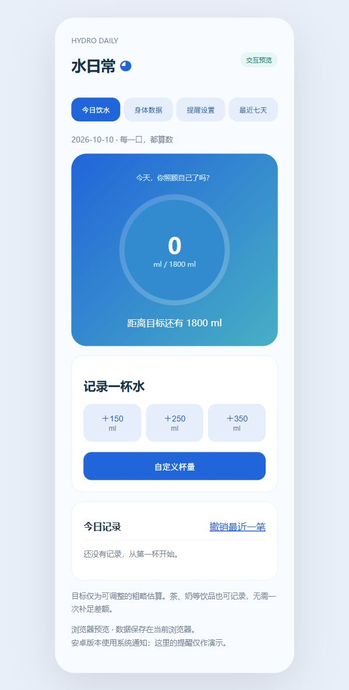

# some coding trash

一个奇奇怪怪的coding垃圾桶。

**AI coding** — 记录通过 AI 辅助开发的实用小项目。当前项目：**水日常（HydroDaily）**，一款中文安卓饮水记录与提醒应用。

由用户提出需求，OpenAI Codex / GPT 辅助生成代码、交互预览与构建文件。这个版本是可体验的原型，欢迎提出问题和改进建议。

## 下载与安装

- [下载安卓安装包 HydroDaily 1.0（测试版）](downloads/HydroDaily-1.0-debug.apk?raw=true)
- [下载项目源码压缩包](downloads/HydroDaily-source.zip?raw=true)
- [APK SHA-256 校验值](downloads/SHA256SUMS.txt)

支持 **Android 8.0 及以上**。将 APK 下载到安卓手机后打开，按手机提示允许此次安装。安装完成后打开「水日常」。这不是 Google Play 发布版本，使用测试签名，尚未做真机兼容性与通知测试。

## 使用方式

1. 打开「身体数据」，填写体重、今日运动分钟、是否处于炎热环境，再保存。体重沿用；运动和炎热状态只对填写当天生效。
2. 自动目标只是粗略的产品估算。可填写手动每日目标覆盖自动结果；填写 0 恢复自动模式。
3. 在「今日」点击 150 / 250 / 350 ml 记录一杯，或输入自定义杯量。录错可「撤销最近一笔」。
4. 打开「提醒」，启用提醒，设置开始时间、结束时间和间隔，然后保存。Android 13 及以上需要允许通知；拒绝后可通过页面里的系统通知设置入口重新开启。
5. 在「历史」查看最近七天的记录。当天目标完成后，后续按需饮用，当天不再发提醒。

提醒间隔范围为 30–180 分钟；开始时间须早于结束时间，暂不支持跨午夜作息。系统省电和手机厂商的后台管理可能延迟通知；强行停止应用后需重新打开。

## 功能

- 中文界面、今日目标与进度。
- 按当天填写数据进行可覆盖的粗略目标估算。
- 快捷杯量、自定义杯量、饮水日志与撤销。
- 作息时段与间隔提醒、通知权限设置、达标停提醒。
- 最近七天记录；数据本机保存，无账号、无网络权限。

## 交互预览

下载项目后，用浏览器打开根目录的 [preview.html](preview.html)。这是独立浏览器演示，数据保存在当前浏览器，与安卓应用数据分开；提醒按钮仅模拟提示，不发后台系统通知。

预览与安卓端包含相同的主要功能流程，但界面实现不同，下面图片展示的是浏览器演示。



## 源码与构建

原生 **Java + Android SDK**，没有第三方运行时依赖。

| 项目 | 版本 |
| --- | --- |
| 最低安卓版本 | Android 8.0 / API 26 |
| compileSdk / targetSdk | 35 |
| JDK | 17 |
| Gradle | 8.9 |
| Android Gradle Plugin | 8.7.3 |

安装 Android Studio、JDK 17、SDK 35 和 Gradle 8.9 后，打开根目录同步项目。项目尚未包含 Gradle Wrapper，可以先在根目录执行：

```bash
gradle wrapper --gradle-version 8.9
```

在 Windows 执行：

```powershell
.\gradlew.bat assembleDebug lintDebug
```

macOS / Linux 执行：

```bash
./gradlew assembleDebug lintDebug
```

测试 APK 输出位置：`app/build/outputs/apk/debug/app-debug.apk`。首次同步需联网，使用 Android SDK 须接受 Google 的许可协议。商店发布需要自行配置正式签名；新电脑生成的测试签名与这里下载的 APK 可能不同，更换签名时不能直接覆盖安装，卸载会丢失本机数据。

目录说明：

```text
app/src/main/java/com/hydrodaily/app/  安卓功能源码
app/src/main/res/                     应用图标、名称与备份规则
downloads/                           APK、源码压缩包及校验值
docs/BUILD-NOTES.md                   构建记录与验证限制
preview.html                         可点击浏览器预览
```

## 目标估算与数据说明

自动目标 = 体重 kg × 30 + 当日运动分钟 × 5 + 炎热时 250 ml，取 50 的倍数并限制在 1200–3500 ml。**这是未经过临床验证的产品规则，不是医学处方，也不能计算出精确的个人生理需求。** 手动目标范围 500–5000 ml 只是输入范围，不代表安全饮水范围；不要为达标一次补足差额。

应用用于一般成年人的生活记录。儿童、孕哺期、有心肾疾病或限水医嘱者应按专业建议设置手动目标。茶、奶等饮品可记录，食物含水量未计入。[NHS 饮水指南](https://www.nhs.uk/live-well/eat-well/food-guidelines-and-food-labels/water-drinks-nutrition/)提供日常补水背景信息，不验证上述公式。

安卓端数据只保存在本机，关闭数据备份；卸载会清除记录。本项目不包含个人饮水数据、开发机器缓存或签名私钥。

## 验证状态

已完成 Java 类编译、Gradle APK 打包、Android Lint 检查（0 错误）、APK v2 签名验证和 ZIP 对齐验证。浏览器预览已检查快捷记录和撤销。**尚未进行真机安装及通知测试。** 本机构建过程中遇到 SDK 文件路径权限限制，具体处理和剩余验证项见 [构建说明](docs/BUILD-NOTES.md)。
